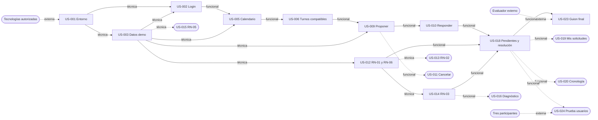

# TurnoLibre — Catálogo de requisitos V0 (borrador)

Línea base: **requisitos-v0-borrador** · Revisión acumulada hasta D-21 (07/10/2026) · Decisiones de alcance en el apartado 5, estimaciones consensuadas y revisión técnica del TL incorporadas.

Cada épica enlaza su ficha de historias. Se conservan 24 historias; las decisiones del PO constan al final y los pendientes vigentes se recogen en el apartado 6.

## 1. Épicas

| ID | Épica | Objetivos | Alcance | Historias |
|---|---|---|---|---|
| EP-001 | [Base del producto: acceso y datos de demostración](../EP-001-base-del-producto/spec.md) | G04 | S-04, S-05 | US-001 – US-004 |
| EP-002 | [Calendario de turnos](../EP-002-calendario-de-turnos/spec.md) | G01 | S-03 | US-005 – US-006 |
| EP-003 | [Intercambio de turnos](../EP-003-intercambio-de-turnos/spec.md) | G01 | S-01, estado básico S-03 | US-007 – US-011 |
| EP-004 | [Validación de reglas](../EP-004-validacion-de-reglas/spec.md) | G02 | S-02 | US-012 – US-016 |
| EP-005 | [Aprobación del responsable](../EP-005-aprobacion-del-responsable/spec.md) | G03 | S-02, historial básico S-03 | US-017 – US-018 |
| EP-006 | [Vistas ampliadas de estado e historial](../EP-006-estado-e-historial/spec.md) | G01, G03 | S-03 | US-019 – US-022 |
| EP-007 | [Calidad y entrega](../EP-007-calidad-y-entrega/spec.md) | G04 | M01, M03, M04 | US-023 – US-024 |

## 2. Catálogo (24 historias)

Muestra detallada (necesidad, objetivo, criterios, reglas, restricciones, NFR, ejemplos, casos límite, dependencias y supuestos): **US-002, US-009, US-012, US-013, US-014, US-018** (6).

| ID | Historia | Épica | MoSCoW | Incertidumbre | Predecesoras | Plan | PO | SM | TL | QA | **Consenso** | **Tras D-18** |
|---|---|---|---|---|---|---|---|---|---|---|---|---|
| US-001 | Preparar el entorno base | EP-001 | Must | Media | —; externa: confirmación de tecnologías autorizadas | IT-001 | 6 | 5 | 5 | 5 | **5** | **5** |
| US-002 | Iniciar sesión con rol | EP-001 | Must | Media | US-001 (técnica), US-003 (técnica) | IT-002 | 6 | 5 | 8 | 5 | **5** | **3** |
| US-003 | Cargar los datos de demostración | EP-001 | Must | Media | US-001 (técnica) | IT-001 | 6 | 5 | 5 | 5 | **5** | **3** |
| US-004 | Mantener los turnos del cuadrante | EP-001 | Could | Media | US-002 (funcional), US-003 (técnica), US-012 (técnica), US-013 (técnica), US-014 (técnica) | Sin compromiso; tras Must | 5 | 8 | 5 | 5 | **5** | **5** |
| US-005 | Consultar mi calendario de turnos | EP-002 | Must | Baja | US-002 (funcional), US-003 (técnica) | IT-002 | 4 | 5 | 3 | 3 | **5** | **3** |
| US-006 | Consultar los turnos de compañeros compatibles | EP-002 | Must | Baja | US-005 (funcional) | IT-002 | 3 | 3 | 2 | 3 | **3** | **3** |
| US-007 | Publicar un turno para cambiar | EP-003 | Won't (fuera de versión) | Baja | US-005 (funcional) | Fuera de versión | 3 | 3 | 2 | 3 | **3** | **3** |
| US-008 | Ver los turnos publicados compatibles | EP-003 | Won't (fuera de versión) | Baja | US-007 (funcional) | Fuera de versión | 3 | 3 | 3 | 3 | **3** | **3** |
| US-009 | Proponer un intercambio | EP-003 | Must | Media | US-006 (funcional), US-003 (técnica) | Por replanificar (D-18) | 7 | 8 | 5 | 8 | **8** | **8** |
| US-010 | Responder a una propuesta | EP-003 | Must | Baja | US-009 (funcional) | Por replanificar (D-18) | 3 | 5 | 3 | 3 | **3** | **3** |
| US-011 | Cancelar una publicación o propuesta | EP-003 | Should | Baja | US-009 (funcional) | Sin compromiso; tras Must | 3 | 3 | 2 | 3 | **3** | **3** |
| US-012 | Validar descanso mínimo y solapes | EP-004 | Must | Alta | US-003 (técnica). El formato de solicitud se acuerda con US-009, sin requerir esa historia terminada. | IT-003 | 7 | 8 | 8 | 8 | **8** | **5** |
| US-013 | Validar las horas semanales | EP-004 | Should | Alta | US-003 (técnica), US-012 (técnica). El formato de intercambio se acuerda con US-009, sin requerir esa historia terminada. | Sin compromiso; tras Must | 6 | 5 | 8 | 5 | **5** | **3** |
| US-014 | Validar categoría, servicio y cobertura | EP-004 | Must | Media | US-003 (técnica), US-012 (técnica). El formato de intercambio se acuerda con US-009, sin requerir esa historia terminada. | Por replanificar (D-18) | 4 | 5 | 5 | 5 | **5** | **3** |
| US-015 | Validar la antelación mínima | EP-004 | Should | Baja | US-003 (técnica). El formato de solicitud se acuerda con US-009, sin requerir esa historia terminada. | Sin compromiso; tras Must | 2 | 3 | 3 | 2 | **3** | **3** |
| US-016 | Ampliar el diagnóstico de reglas | EP-004 | Should | Baja | US-012 (funcional), US-013 (funcional), US-014 (funcional), US-015 (funcional) | Sin compromiso; tras Must | 2 | 5 | 2 | 2 | **2** | **2** |
| US-017 | Consultar solicitudes y decisiones del servicio | EP-005 | Fusionada en US-018 | Media | — (fusionada en US-018) | Fusionada en US-018 | 5 | 5 | 5 | 5 | **5** | — |
| US-018 | Resolver una solicitud | EP-005 | Must | Alta | US-010 (funcional), US-012 (funcional), US-014 (funcional) | Por replanificar (D-18) | 7 | 8 | 8 | 8 | **8** | **8** |
| US-019 | Consultar una vista unificada de mis solicitudes | EP-006 | Should | Baja | US-009 (funcional), US-010 (funcional), US-018 (funcional) | Sin compromiso; tras Must | 3 | 3 | 3 | 3 | **3** | **3** |
| US-020 | Consultar una cronología ampliada de intercambios | EP-006 | Should | Baja | US-018 (funcional) | Sin compromiso; tras Must | 3 | 5 | 3 | 3 | **3** | **3** |
| US-021 | Recibir avisos dentro de la aplicación | EP-006 | Could | Media | US-019 (funcional) | Sin compromiso; tras Must | 4 | 3 | 2 | 3 | **3** | **3** |
| US-022 | Filtrar el historial | EP-006 | Won't | Baja | US-020 (funcional) | Fuera de versión | 2 | 3 | 2 | 2 | **2** | **2** |
| US-023 | Crear el guion inicial de instalación y evaluación | EP-007 | Must | Baja | US-018 (funcional); externa: evaluador ajeno a la implementación | Por replanificar (D-18) | 4 | 5 | 3 | 3 | **5** | **2** |
| US-024 | Prueba de usabilidad y accesibilidad básica | EP-007 | Should | Media | US-010 (funcional), US-018 (funcional), US-023 (funcional); externa: tres participantes ajenos al equipo | Sin compromiso; review final si cabe | 3 | 5 | 5 | 3 | **5** | **3** |

**Estimación individual del PO · 02/10/2026:** horas-persona para implementación, integración, pruebas y documentación, con apoyo de IA y revisión humana incluidos. El PO confirma las cifras sin reducción adicional: **Must 76 h-p, Should 11, Could 12 y Won't 2** (esta última fuera de versión). Las opciones incluidas sumarían 99 h-p. Son estimaciones individuales, no consenso ni compromiso de capacidad; no incluyen de nuevo el esfuerzo de las historias predecesoras. Las reuniones, la coordinación y el margen se descuentan en la capacidad.

**Estimación consensuada · Planning Poker del 06/10/2026:** cada miembro estimó primero de forma individual (columnas PO, SM, TL y QA) y después se votó en grupo. Historias con diferencia de 3 h o más (US-002, US-004, US-009, US-013 y US-016) se discutieron y se volvieron a votar; en el resto se tomó el valor de la mayoría. **Regla de empate acordada:** con dos votos a cada valor (US-005, US-015, US-023 y US-024) se toma el valor más alto, por prudencia. Solo se usan valores de la escala 1, 2, 3, 5, 8 y 13.

| Prioridad | PO | SM | TL | QA | **Consenso** |
|---|---|---|---|---|---|
| Must | 76 | 83 | 79 | 74 | **81** |
| Should | 11 | 16 | 10 | 11 | **11** |
| Could | 12 | 14 | 9 | 11 | **11** |
| Won't | 2 | 3 | 2 | 2 | **2** |

**Comparación histórica anterior a D-21:** la capacidad efectiva del equipo es **46,35 h** (`docs/organization/capacity.md`). Las Must consensuadas (**81 h**) la superan en **≈ 35 h**: el alcance Must no cabía. **Resuelto en D-18:** tras los recortes, las Must suman 46 h-p (ver "Ajuste de alcance D-18").

### Ajuste de alcance D-18 · 06/10/2026

Para que las Must quepan en la capacidad, el PO acepta los recortes propuestos por la SM y el equipo vota las estimaciones de las historias simplificadas:

- Un solo servicio en los datos de demostración, calendario en lista e inicio de sesión sin bloqueo por intentos fallidos.
- Datos de demostración sin cambios de hora. RN-04 se comprueba al preparar los datos; los intercambios siguen siendo uno a uno dentro de la misma categoría y servicio.
- RN-02 (US-013) y RN-05 (US-015) pasan a Should; G02 se actualiza.
- Propuesta directa sobre un turno de un compañero compatible: US-006 pasa a Must y US-007/US-008 quedan fuera de esta versión, conservando sus identificadores.
- Una sola pantalla para consultar pendientes y resolverlas: US-017 se fusiona en US-018, votada en **8 h-p** (la suma daba 9, que no existe en la escala).
- Guion mínimo de instalación al final (US-023, 2 h-p); G04 y M04 pasan a evaluar la versión final.
- La prueba con usuarios (US-024) pasa a Should; M01 se ajusta al flujo sin publicación y queda pendiente de validación si no se hace la prueba.
- Se mantienen una única propuesta activa por turno y la aprobación del responsable.

| Prioridad tras D-18 | Historias | h-p |
|---|---|---|
| **Must** | US-001, 002, 003, 005, 006, 009, 010, 012, 014, 018, 023 | **46** |
| Should | US-011, 013, 015, 016, 019, 020, 024 | 20 |
| Could | US-004, 021 | 8 |
| Won't / fuera de versión | US-007, 008, 022 | 8 |
| Fusionada | US-017 (en US-018) | — |

**D-21 (07/10/2026): Must 46 h-p frente a 57,65 h de capacidad** en el periodo 21/10–01/12, con 6 h semanales por persona. Quedan 11,65 h sin comprometer. El reparto por sprint aún requiere ajustes; las Should no se incorporan automáticamente.

**Reparto MoSCoW antes de D-18:** 16 Must · 4 Should · 3 Could · 1 Won't. US-024 pasa a Must porque aporta la evidencia de las métricas acordadas; su esfuerzo se acota a tres participantes.

El peso de Must se calculará con horas consensuadas divididas entre capacidad efectiva del equipo. El reparto por número de historias no mide carga ni demuestra que el alcance quepa. Las Should/Could solo se incorporan tras cubrir las Must y los controles de calidad.

### Criterio de priorización

- **Must:** sin la historia no se cumple alguno de G01–G04, o bloquea a otra Must (p. ej. US-001, US-003 por dependencia técnica).
- **Should:** mejora el flujo básico. US-019 reúne solicitudes en una pantalla y US-020 añade una cronología; el estado y el historial básicos ya se entregan con US-009/010/018 (US-017 está fusionada en US-018). US-016 amplía mensajes que ya incluyen regla y motivo en las Must.
- **Could:** comodidad o funcionalidad cubierta en parte por otra historia.
- **Won't:** descartada en esta versión de forma explícita.
- En empate, se adelanta la historia con más **riesgo** (incertidumbre alta o ligada a RT-01–RT-03) para descubrir problemas pronto.

## 3. Dependencias

### Dependencias tras D-18 (06/10/2026)

Este diagrama sustituye al grafo anterior a D-18, conservado en el historial de Git. Se muestran las Must (fondo continuo) y las Should (borde discontinuo); US-007, US-008 y US-017 ya no aparecen.

**Cadena crítica de las Must:** US-001 → US-003 → US-002 → US-005 → US-006 → US-009 → US-010 → US-018 → US-023.

Tipos: **funcional** (necesita el comportamiento de otra historia), **técnica** (necesita infraestructura o un módulo compartido), **externa** (depende de algo fuera del equipo).

## 4. Plan inicial por iteración

### Revisión D-21 · 07/10/2026

Periodo 21/10–01/12/2026, con 6 h semanales por persona. Se conservan provisionalmente las asignaciones de D-18 para mostrar los desequilibrios que SM/TL deben resolver en H3. No representan una carga ya aprobada por persona.

| Release | Iteración | Fechas | Capacidad | Historias Must | Carga | ¿Cabe? |
|---|---|---|---:|---|---:|---|
| R1 | IT-001 | 21/10–27/10 | 10,18 h | US-001, US-003 | 8 h-p | Sí |
| R1 | IT-002 | 28/10–03/11 | 6,78 h | US-002, US-005, US-006 | 9 h-p | **No (+2,23 h)** |
| R2 | IT-003 | 04/11–10/11 | 12,73 h | US-012 | 5 h-p | Sí |
| R2 | IT-004 | 11/11–17/11 | 9,33 h | US-009 | 8 h-p | Sí |
| R3 | IT-005 | 18/11–24/11 | 9,33 h | US-010, US-014 | 6 h-p | Sí |
| R3 | IT-006 | 25/11–01/12 | 9,33 h | US-018, US-023 | 10 h-p | **No (+0,68 h)** |
| | | **Total** | **57,65 h** | | **46 h-p** | **Cabe el total** |

Quedan **11,65 h sin comprometer**, pero IT-002 e IT-006 requieren redistribución. Las historias de 8 h-p ya caben en varios sprints a nivel de equipo; repartirlas en tareas entre varias personas debe respetar las capacidades individuales y las dependencias. No se rebajan estimaciones ni se añaden Should para llenar el margen. El plan definitivo de H3 queda a cargo de SM/TL, con revisión de alcance del PO.

## 5. Decisiones del PO · 01/10/2026

Registro histórico: los recortes de D-18 sustituyen las decisiones de alcance afectadas; D-21 actualiza dedicación, fechas y capacidad. Esta sección no define el alcance vigente.

1. **Alcance y capacidad:** mantener las seis reglas de negocio, incluida RN-02, y la consulta básica de estado e historial. Para reducir esfuerzo, aplazar primero avisos internos (US-021), consulta de turnos no publicados de compañeros (US-006) y gestión manual del cuadrante (US-004). Después, recortar ampliaciones de presentación del historial, estado y mensajes (US-020, US-019 y US-016), conservando su información básica; la cancelación (US-011) se aplaza en último lugar. US-022 sigue fuera de esta versión. El recorte y la distribución por sprint se cuantificarán con estimaciones consensuadas y capacidad efectiva; el número de Must no demuestra que la carga quepa. RN-02 debe estar terminada antes de habilitar la aprobación.
2. **Una propuesta activa por turno:** los dos turnos de una solicitud quedan reservados mientras esté Propuesta o Aceptada, pendiente de aprobación. Rechazar o cancelar libera los turnos; aprobar cierra sus publicaciones. No se admiten ofertas simultáneas sobre el mismo turno.
3. **Bloqueo temporal del acceso:** cinco intentos consecutivos con contraseña incorrecta bloquean la cuenta durante 15 minutos desde el quinto fallo. Los intentos durante el bloqueo no alargan el plazo. El contador se reinicia al terminar el bloqueo o tras un acceso correcto. Los mensajes de fallo son genéricos.
4. **Prueba con tres participantes:** sustituir M01 por tres participantes que completen el flujo en menos de cinco minutos cada uno y sin ayuda (3 de 3). El tiempo excluye la aprobación del responsable. Se mantiene M03: tres decisiones del responsable, cada una en menos de un minuto. US-024 se incluye en IT-006.
5. **Datos de demostración:** datos ficticios precargados y restablecibles (US-003) como solución inicial. La pantalla de alta y modificación de turnos (US-004) queda como mejora opcional (Could), sujeta a capacidad disponible.
6. **Calendario:** la consulta del calendario propio (US-005) es imprescindible. Consultar turnos de compañeros que aún no se han publicado (US-006) es opcional, porque US-008 ya permite encontrar ofertas de intercambio.
7. **Cambio de hora:** aplicar el criterio de horas efectivamente trabajadas de RN-02. Horarios, fechas y semanas usan Europe/Madrid; descanso, jornada y antelación se calculan con tiempo realmente transcurrido. Una noche con retraso de una hora dura 11 h y con adelanto, 9 h. El TL decide la implementación, sin cambiar este criterio funcional.

## 6. Pendientes para cerrar la planificación

- Las estimaciones consensuadas y revisadas por D-18 están registradas en el Excel. Para H3, redistribuir IT-002 e IT-006 sin sobreasignar personas.
- Confirmar las tecnologías autorizadas, dependencia externa de US-001.

**Decisión del TL:** con la capacidad de D-21, US-009 y US-018, ambas estimadas en 8 h-p, ya caben en un sprint de equipo de 9,33 h. No es necesario dividirlas en nuevas historias de usuario; en H3 se descompondrán en tareas (TK) y se repartirán entre varias personas respetando las capacidades individuales y las dependencias.