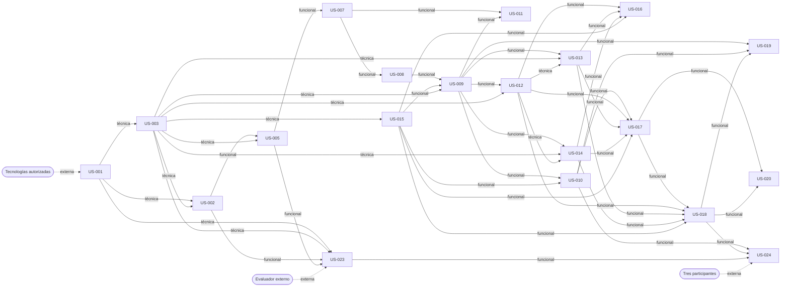

# TurnoLibre — Catálogo de requisitos V0 (borrador)

Línea base: **requisitos-v0-borrador** · Revisión del 02/10/2026 · Decisiones de alcance en el apartado 5 y estimación individual del PO confirmada; pendientes el consenso y la revisión del equipo.
Cada épica enlaza su ficha de historias. Se conservan 24 historias; las decisiones del PO constan al final. El consenso de estimaciones y la aceptación técnica del equipo siguen pendientes.

## 1. Épicas

| ID | Épica | Objetivos | Alcance | Historias |
|---|---|---|---|---|
| EP-001 | [Base del producto: acceso y datos de demostración](../EP-001-base-del-producto/spec.md) | G04 | S-04, S-05 | US-001 – US-004 |
| EP-002 | [Calendario de turnos](../EP-002-calendario-de-turnos/spec.md) | G01 | S-03 | US-005 – US-006 |
| EP-003 | [Intercambio de turnos](../EP-003-intercambio-de-turnos/spec.md) | G01 | S-01, estado básico S-03 | US-007 – US-011 |
| EP-004 | [Validación de reglas](../EP-004-validacion-de-reglas/spec.md) | G02 | S-02 | US-012 – US-016 |
| EP-005 | [Aprobación del responsable](../EP-005-aprobacion-del-responsable/spec.md) | G03 | S-02, historial básico S-03 | US-017 – US-018 |
| EP-006 | [Vistas ampliadas de estado e historial](../EP-006-estado-e-historial/spec.md) | G01, G03 | S-03 | US-019 – US-022 |
| EP-007 | [Calidad y entrega](../EP-007-calidad-y-entrega/spec.md) | G04 | M01, M03, M04 | US-023 – US-024 |

## 2. Catálogo (24 historias)

Muestra detallada (necesidad, objetivo, criterios, reglas, restricciones, NFR, ejemplos, casos límite, dependencias y supuestos): **US-002, US-009, US-012, US-013, US-014, US-018** (6).

| ID | Historia | Épica | MoSCoW | Incertidumbre | Predecesoras | Plan | PO (h-p) |
|---|---|---|---|---|---|---|---|
| US-001 | Preparar el entorno base | EP-001 | Must | Media | —; externa: confirmación de tecnologías autorizadas | IT-001 | 6 |
| US-002 | Iniciar sesión con rol | EP-001 | Must | Media | US-001 (técnica), US-003 (técnica) | IT-002 | 6 |
| US-003 | Cargar los datos de demostración | EP-001 | Must | Media | US-001 (técnica) | IT-001 | 6 |
| US-004 | Mantener los turnos del cuadrante | EP-001 | Could | Media | US-002 (funcional), US-003 (técnica), US-012 (técnica), US-013 (técnica), US-014 (técnica) | Sin compromiso; tras Must | 5 |
| US-005 | Consultar mi calendario de turnos | EP-002 | Must | Baja | US-002 (funcional), US-003 (técnica) | IT-002 | 4 |
| US-006 | Consultar los turnos de compañeros compatibles | EP-002 | Could | Baja | US-005 (funcional) | Sin compromiso; tras Must | 3 |
| US-007 | Publicar un turno para cambiar | EP-003 | Must | Baja | US-005 (funcional) | IT-003 | 3 |
| US-008 | Ver los turnos publicados compatibles | EP-003 | Must | Baja | US-007 (funcional) | IT-003 | 3 |
| US-009 | Proponer un intercambio | EP-003 | Must | Media | US-008 (funcional), US-015 (funcional), US-003 (técnica) | IT-003 | 7 |
| US-010 | Responder a una propuesta | EP-003 | Must | Baja | US-009 (funcional), US-015 (funcional) | IT-004 | 3 |
| US-011 | Cancelar una publicación o propuesta | EP-003 | Should | Baja | US-007 (funcional), US-009 (funcional) | Sin compromiso; tras Must | 3 |
| US-012 | Validar descanso mínimo y solapes | EP-004 | Must | Alta | US-009 (funcional), US-003 (técnica) | IT-004 | 7 |
| US-013 | Validar las horas semanales | EP-004 | Must | Alta | US-009 (funcional), US-003 (técnica), US-012 (técnica) Reutilización de US-012 a revisar por TL. | IT-004 | 6 |
| US-014 | Validar categoría, servicio y cobertura | EP-004 | Must | Media | US-009 (funcional), US-003 (técnica), US-012 (técnica) Reutilización de US-012 a revisar por TL. | IT-004 | 4 |
| US-015 | Validar la antelación mínima | EP-004 | Must | Baja | US-003 (técnica) El formato de solicitud se acuerda con US-009, sin requerir esa historia terminada. | IT-003 | 2 |
| US-016 | Ampliar el diagnóstico de reglas | EP-004 | Should | Baja | US-012 (funcional), US-013 (funcional), US-014 (funcional), US-015 (funcional) | Sin compromiso; tras Must | 2 |
| US-017 | Consultar solicitudes y decisiones del servicio | EP-005 | Must | Media | US-010 (funcional), US-012 (funcional), US-013 (funcional), US-014 (funcional), US-015 (funcional) | IT-005 | 5 |
| US-018 | Resolver una solicitud | EP-005 | Must | Alta | US-017 (funcional), US-012 (funcional), US-013 (funcional), US-014 (funcional), US-015 (funcional) | IT-005 | 7 |
| US-019 | Consultar una vista unificada de mis solicitudes | EP-006 | Should | Baja | US-009 (funcional), US-010 (funcional), US-018 (funcional) | Sin compromiso; tras Must | 3 |
| US-020 | Consultar una cronología ampliada de intercambios | EP-006 | Should | Baja | US-017 (funcional), US-018 (funcional) | Sin compromiso; tras Must | 3 |
| US-021 | Recibir avisos dentro de la aplicación | EP-006 | Could | Media | US-019 (funcional) | Sin compromiso; tras Must | 4 |
| US-022 | Filtrar el historial | EP-006 | Won't | Baja | US-020 (funcional) | Fuera de versión | 2 |
| US-023 | Crear el guion inicial de instalación y evaluación | EP-007 | Must | Baja | US-001 (técnica), US-003 (técnica), US-002 (funcional), US-005 (funcional); externa: evaluador ajeno a la implementación | IT-002 | 4 |
| US-024 | Prueba de usabilidad y accesibilidad básica | EP-007 | Must | Media | US-010 (funcional), US-018 (funcional), US-023 (funcional); externa: tres participantes ajenos al equipo | IT-006 | 3 |

**Estimación individual del PO · 02/10/2026:** horas-persona para implementación, integración, pruebas y documentación, con apoyo de IA y revisión humana incluidos. El PO confirma las cifras sin reducción adicional: **Must 76 h-p, Should 11, Could 12 y Won't 2** (esta última fuera de versión). Las opciones incluidas sumarían 99 h-p. Son estimaciones individuales, no consenso ni compromiso de capacidad; no incluyen de nuevo el esfuerzo de las historias predecesoras. Las reuniones, la coordinación y el margen se descuentan en la capacidad.

**Reparto MoSCoW:** 16 Must · 4 Should · 3 Could · 1 Won't. US-024 pasa a Must porque aporta la evidencia de las métricas acordadas; su esfuerzo se acota a tres participantes.

El peso de Must se calculará con horas consensuadas divididas entre capacidad efectiva del equipo. El reparto por número de historias no mide carga ni demuestra que el alcance quepa. Las Should/Could solo se incorporan tras cubrir las Must y los controles de calidad.

### Criterio de priorización

- **Must:** sin la historia no se cumple alguno de G01–G04, o bloquea a otra Must (p. ej. US-001, US-003 por dependencia técnica).
- **Should:** mejora el flujo básico. US-019 reúne solicitudes en una pantalla y US-020 añade una cronología; el estado y el historial básicos ya se entregan con US-009/010/017/018. US-016 amplía mensajes que ya incluyen regla y motivo en las Must.
- **Could:** comodidad o funcionalidad cubierta en parte por otra historia.
- **Won't:** descartada en esta versión de forma explícita.
- En empate, se adelanta la historia con más **riesgo** (incertidumbre alta o ligada a RT-01–RT-03) para descubrir problemas pronto.

## 3. Dependencias

Tipos: **funcional** (necesita el comportamiento de otra historia), **técnica** (necesita infraestructura o un módulo compartido), **externa** (depende de algo fuera del equipo).

El diagrama muestra Must y Should. La tabla recoge también las dependencias de Could y Won't; el TL revisará las dependencias técnicas y la incertidumbre.

**Cadena de dependencias de ejemplo:** US-001 → US-003 → US-002 → US-005 → US-007 → US-008 → US-009 → US-012 → US-013 → US-017 → US-018 → US-024. El camino crítico se calculará con estimaciones y asignación de recursos; la aprobación necesita todas las reglas.

## 4. Plan inicial por iteración

Distribución provisional de precedencias, pendiente de estimaciones y capacidad efectiva. No representa trabajo ya realizado ni un compromiso de carga. Las historias que excedan un sprint se dividirán con TL/QA antes de planificarlas.

| Release | Iteración | Fechas de 2026 | Historias Must | Control de entrega |
|---|---|---|---|---|
| R1 | IT-001 | 23/09–29/09 | US-001, US-003 | Entorno y datos de demostración |
| R1 | IT-002 | 30/09–06/10 | US-002, US-005, US-023 | Instalar y evaluar R1 desde cero |
| R2 | IT-003 | 07/10–13/10 | US-007, US-008, US-015, US-009 | Descontar o reubicar las horas del festivo 12/10 |
| R2 | IT-004 | 14/10–20/10 | US-010, US-012, US-013, US-014 | Actualizar guion y evaluar R2; validar carga de reglas |
| R3 | IT-005 | 21/10–27/10 | US-017, US-018 | Aprobar con todas las reglas y consultar decisiones |
| R3 | IT-006 | 28/10–03/11 | US-024 | Prueba con tres participantes y evaluación limpia de R3 |

US-011, US-016, US-019 y US-020 se incorporan solo si cabe su esfuerzo después de las Must; a continuación US-004, US-006 y US-021. US-022 queda fuera de esta versión. Las actualizaciones del guion y las comprobaciones de cada release se incluyen en el esfuerzo de sus historias; US-023 no se contabiliza tres veces.

## 5. Decisiones del PO · 01/10/2026

1. **Alcance y capacidad:** mantener las seis reglas de negocio, incluida RN-02, y la consulta básica de estado e historial. Para reducir esfuerzo, aplazar primero avisos internos (US-021), consulta de turnos no publicados de compañeros (US-006) y gestión manual del cuadrante (US-004). Después, recortar ampliaciones de presentación del historial, estado y mensajes (US-020, US-019 y US-016), conservando su información básica; la cancelación (US-011) se aplaza en último lugar. US-022 sigue fuera de esta versión. El recorte y la distribución por sprint se cuantificarán con estimaciones consensuadas y capacidad efectiva; el número de Must no demuestra que la carga quepa. RN-02 debe estar terminada antes de habilitar la aprobación.
2. **Una propuesta activa por turno:** los dos turnos de una solicitud quedan reservados mientras esté Propuesta o Aceptada, pendiente de aprobación. Rechazar o cancelar libera los turnos; aprobar cierra sus publicaciones. No se admiten ofertas simultáneas sobre el mismo turno.
3. **Bloqueo temporal del acceso:** cinco intentos consecutivos con contraseña incorrecta bloquean la cuenta durante 15 minutos desde el quinto fallo. Los intentos durante el bloqueo no alargan el plazo. El contador se reinicia al terminar el bloqueo o tras un acceso correcto. Los mensajes de fallo son genéricos.
4. **Prueba con tres participantes:** sustituir M01 por tres participantes que completen el flujo en menos de cinco minutos cada uno y sin ayuda (3 de 3). El tiempo excluye la aprobación del responsable. Se mantiene M03: tres decisiones del responsable, cada una en menos de un minuto. US-024 se incluye en IT-006.
5. **Datos de demostración:** datos ficticios precargados y restablecibles (US-003) como solución inicial. La pantalla de alta y modificación de turnos (US-004) queda como mejora opcional (Could), sujeta a capacidad disponible.
6. **Calendario:** la consulta del calendario propio (US-005) es imprescindible. Consultar turnos de compañeros que aún no se han publicado (US-006) es opcional, porque US-008 ya permite encontrar ofertas de intercambio.
7. **Cambio de hora:** aplicar el criterio de horas efectivamente trabajadas de RN-02. Horarios, fechas y semanas usan Europe/Madrid; descanso, jornada y antelación se calculan con tiempo realmente transcurrido. Una noche con retraso de una hora dura 11 h y con adelanto, 9 h. El TL decide la implementación, sin cambiar este criterio funcional.

## 6. Pendientes para cerrar la planificación

- Estimaciones individuales de los demás integrantes, consenso del Planning Poker y capacidad efectiva por persona y sprint. La estimación del PO ya está registrada.
- Revisión del TL de dependencias, tecnologías y división de historias con incertidumbre alta; implementación del cómputo temporal definido en las reglas.
- Revisión de QA de criterios y asignación de IDs NFR y umbrales pendientes. Las reglas se prueban en el servidor, incluidos casos límite.
- Formalizar en el registro de decisiones del equipo la actualización de M01 a tres participantes. El PO comunica el visto bueno de SM al mensaje de alcance y disponibilidad; no equivale al consenso de estimaciones ni a la validación técnica y de QA.
